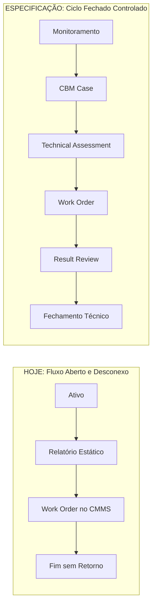
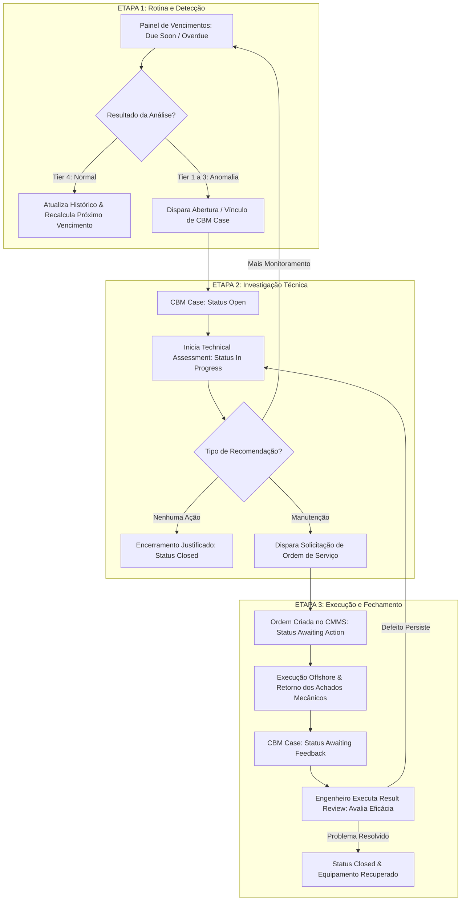

# Relatório Executivo: Revisão da Especificação Técnica CBM e Análise de Mudanças
**Documento de Referência:** `APM CBM PLATFORM - FUNCTIONAL SPECIFICATION (IS93502 / OOSDOMPF000019 / Rev. C1)`  
**Aplicação Atual:** CBM App (`CBM-Application`)  
**Público-Alvo:** Gestão de Produto, Liderança de Operações e Engenharia  
**Data:** Outubro de 2026  

---

## 1. Sumário Executivo para a Gestão

Este documento apresenta uma análise executiva da especificação funcional da plataforma CBM (*Condition-Based Monitoring*) da SBM Offshore em comparação com o código atualmente desenvolvido.

### A Principal Conclusão para a Liderança:
A aplicação atual possui uma base sólida de interface e cadastro de ativos e ordens, mas opera como um **"catálogo de relatórios estáticos"**. 

A especificação técnica exige uma transformação estrutural: transformar a ferramenta em um **"Gerenciador de Casos de Ciclo Fechado"** (*Closed-Loop Case Management*). Isso introduz conceitos soberanos ausentes no software hoje, principalmente o **CBM Case** (o caso como unidade de gestão), o **Technical Assessment** (o laudo técnico de engenharia) e o **Result Review** (a comprovação pós-manutenção).

---

## 2. O Que É Regra de Negócio vs. O Que É Prescrição Desnecessária

Para assegurar autonomia à equipe de produto sem violar normas da companhia, alinhamos o que deve ser rigorosamente seguido e o que deve ser flexibilizado:

### 2.1 Regras de Negócio Legítimas (Manter Rigorosamente)
1. **Fórmulas de Matriz de Risco Corporativa (Seção 6.5.10):**
   * $\text{Risco de Falha (1 a 12)} = \text{Severidade da Condição (1 a 4)} \times \text{Criticidade do Ativo (1 a 3)}$.
   * $\text{Risco de Conformidade (0 a 15)} = \text{Índice de Atraso da Análise (0 a 5)} \times \text{Criticidade do Ativo (1 a 3)}$.
   * $\text{Risco Total CBM (1 a 15)} = \text{Risco de Falha} + (20\% \times \text{Risco de Conformidade})$.
   * *Impacto para a Gestão:* Permite priorizar investimentos e manutenções com base em risco objetivo, não em intuição.
2. **Independência das Técnicas de Monitoramento:** Uma análise de vibração em dia **não prorroga** o vencimento de uma análise de óleo no mesmo equipamento.
3. **Salvaguarda de Fechamento Técnico:** Concluir o reparo mecânico no offshore **não encerra** o caso de CBM automaticamente. Exige validação de engenharia.

### 2.2 Prescrições Desnecessárias (Flexibilizar para Dar Autonomia ao Time)
1. **Citação de Softwares Específicos (Seções 9.1 e 9.6):** A especificação cita marcas de fornecedores legados (*System 1, OptSite, SEEQ, Emerson*). A gestão deve aprovar o uso de **APIs padronizadas**, permitindo trocar ferramentas de medição sem reescrever o sistema.
2. **Exigência de Arquivos de Texto/Planilhas (Seção 6.4.4):** A especificação menciona geração de arquivos estáticos (Word/Excel). A solução moderna de produto deve focar em **laudos digitais interativos na web**, exportáveis para PDF apenas para auditorias externas.
3. **Simulação de Telas do ERP IFS (Seção 6.4.5):** O sistema deve disparar solicitações de ordens de serviço por contratos modernos de integração, sem forçar telas que imitam formulários legados.

---

## 3. Os Novos Objetos de Negócio (*Business Object Model* - Seção 6.1.1)

A especificação introduz 9 objetos fundamentais de negócio. A tabela abaixo sintetiza o papel de cada um e o impacto da sua ausência no código atual:

| Objeto de Negócio | O Que Representa no Negócio? | Situação no Código Atual | O Que Muda para o Gestor e Usuário? |
| :--- | :--- | :---: | :--- |
| **1. Equipment Item** | O ativo físico cadastrado no ERP (IFS) sob escopo formal de CBM regulamentar. | **Implementado** (parcial) | Adiciona a confirmação formal de escopo CBM (`isCbmScope = TRUE`) para auditorias de Classe. |
| **2. Monitoring Plan Item** | O compromisso de monitoramento do ativo por técnica (ex: Bomba A + Vibração + Frequência Mensal). | **Ausente** (estático) | Permite ao gestor enxergar a programação anual de monitoramento de cada FPSO. |
| **3. Measurement Activity** | O evento da coleta de campo (se o técnico coletou a medição offshore ou justificou o motivo). | **Ausente** | Controla os motivos reais de não medição (`Not Required`), expondo gargalos de coleta. |
| **4. Monitoring Analysis Record** | O registro do parecer técnico do analista, classificando o ativo em Tier 1 a 4. | **Parcial** (misturado) | Separa o momento da medição no mar do momento da conclusão do laudo em terra. |
| **5. CBM Case** | **O container soberano de gestão da anomalia.** Centraliza prazos, dono e status de resolução. | **TOTALMENTE AUSENTE** | **A mudança mais crítica:** o gestor ganha um painel de casos com SLA, responsável e máquina de estados. |
| **6. Technical Assessment** | **O estudo técnico aprofundado dentro do CBM Case.** Identifica o defeito e a norma ISO 14224. | **TOTALMENTE AUSENTE** | O analista registra um ou múltiplos pareceres técnicos dentro do mesmo caso ao longo do tempo. |
| **7. Recommendation & Action** | O direcionamento prático: Mais Monitoramento, Ação Operacional ou Manutenção Corretiva. | **Parcial** (texto livre) | Classifica formalmente o próximo passo do caso, direcionando o fluxo operacional. |
| **8. Fault Report / Work Order** | A ordem de serviço no CMMS (IFS) disparada a partir da recomendação de manutenção. | **Implementado** (parcial) | Passa a estar formalmente vinculada ao CBM Case, prestando contas de execução à engenharia. |
| **9. Result Review & Technical Closure** | A conferência pós-reparo: validação dos achados do mecânico e eficácia da intervenção. | **TOTALMENTE AUSENTE** | Garante que nenhuma ordem seja esquecida e impede que a máquina volte a operar com defeito residual. |

---

## 4. Mapeamento dos Novos Status Inexistentes na Aplicação

Hoje, o software possui apenas status simples de equipamentos (`Good`, `Degraded`, `Critical`) e ordens (`Pending`, `Observed`, `Completed`). 

A especificação técnica exige **quatro novos grupos de status** essenciais para o controle da operação:

### 4.1 Máquina de Estados do `CBM Case` (Inexistente no Código Atual)
Este é o fluxo que rege a governança da anomalia desde a detecção até o encerramento formal:

| Novo Status do Caso | Significado Operacional no Negócio | Ação do Usuário / Gatilho |
| :--- | :--- | :--- |
| **`Open`** | Caso recém-aberto por anomalia (Tier 1 a 3) ou alarme online. Aguarda início da análise. | Triagem do analista CBM e designação do responsável técnico. |
| **`In Progress`** | Investigação técnica em andamento pelo engenheiro responsável (*Technical Assessment*). | Diagnóstico de falha, análise de espectros e definição da recomendação. |
| **`Awaiting Action`** | Laudo concluído exigindo intervenção. Ordem de serviço enviada ao offshore. | Aguardando equipe de bordo programar e executar a manutenção. |
| **`Awaiting Feedback`** | Manutenção mecânica concluída no mar. Aguarda conferência técnica de engenharia. | Notifica o analista CBM para avaliar os achados relatados pelo mecânico. |
| **`Closed`** | Caso encerrado com sucesso após validação de eficácia e normalização do ativo. | Registro formal do *Result Review* e reavaliação da saúde do equipamento. |
| **`Cancelled`** | Caso invalidado por alarme falso, duplicidade ou erro de sensor. | Registro obrigatório de justificativa de cancelamento para auditoria. |

---

### 4.2 Status de Vencimento da Análise (*Analysis Due Status*)
Permite ao gestor identificar antecipadamente ativos que correm risco de perder a certificação:

| Novo Status de Vencimento | Regra de Negócio | Impacto na Gestão |
| :--- | :--- | :--- |
| **`Not Yet Due`** | Prazo de análise vigente dentro da periodicidade acordada. | Ativo em conformidade total. |
| **`Due Soon`** | Vencimento se aproxima (dentro da janela de aviso configurável, ex: 7 dias). | Alerta de planejamento para a equipe onshore. |
| **`Due`** | Data limite de realização da análise atingida. | Prioridade imediata de fila de trabalho. |
| **`Overdue`** | Prazo extrapolado sem realização de análise válida. | Penaliza o KPI de conformidade e eleva o risco do ativo. |
| **`Unable to Determine`** | Dados cadastrais incompletos no ERP (falta frequência ou data base). | Alerta de inconsistência cadastral a ser corrigida no IFS. |

---

### 4.3 Status de Coleta de Medição (*Collection Status*)
Separa o atraso do operador em campo do atraso do analista em terra:

| Novo Status de Coleta | Significado Operacional | Regra Mandatória de Governança |
| :--- | :--- | :--- |
| **`Pending`** | Ciclo de medição aberto, aguardando execução da rota de coleta offshore. | Status padrão de início do mês. |
| **`Collected`** | Dados coletados integralmente no ativo conforme rota planejada. | Habilita o início do laudo técnico. |
| **`Partially Collected`** | Apenas alguns pontos foram medidos (ex: motor acessível, redutor inacessível). | Exige justificativa técnica da restrição em campo. |
| **`Not Collected`** | Rota de medição não foi realizada pela equipe de bordo no período. | Conta como não conformidade no indicador da embarcação. |
| **`Not Required`** | Coleta não aplicável no mês por motivo aprovado (ex: máquina em parada geral). | **Não penaliza o KPI**, mas exige justificativa formal auditável. |
| **`Unable to Confirm`** | Informações insuficientes para confirmar se a rota foi realizada. | Identificado como exceção de qualidade de dados. |

---

### 4.4 Status da Avaliação Técnica (*Technical Assessment Status*)
Controla a elaboração dos laudos pelos engenheiros:
* **`Not Started`** $\rightarrow$ **`In Progress`** $\rightarrow$ **`Completed`** (laudo assinado e válido) $\rightarrow$ **`Invalidated`** (análise descartada por ruído de medição, não zera o vencimento).

---

## 5. A Nova Jornada do Usuário (Baseada na Figura 6.1.1 da Especificação)

A maior transformação perceptível para a gestão e para os operadores é a substituição do fluxo pontual e aberto por uma **jornada integrada de ciclo fechado**:

### 5.1 O Que Muda na Prática em Cada Etapa:

#### Etapa 1: Rotina de Vigilância e Ponto de Partida
* **Como é Hoje:** O usuário entra em uma tabela de equipamentos estática. Para relatar uma anomalia, precisa preencher um formulário isolado de "Novo Relatório" do zero.
* **Com a Especificação:** O usuário entra em uma visão de rotina com contadores de pendências (`Due Soon`, `Overdue`). Se o ativo estiver saudável (**Tier 4**), o sistema apenas registra a conformidade e recalcula o vencimento. Se houver anomalia (**Tier 1 a 3**) ou alarme online, o sistema conduz o usuário diretamente para o **CBM Case**.

#### Etapa 2: O Caso CBM e a Avaliação Técnica
* **Como é Hoje:** Não existe o conceito de caso. Recomendações ficam soltas, sem rastreamento de quem é o responsável pela resolução do problema.
* **Com a Especificação:** 
  1. O sistema faz a **checagem de duplicidade**: se já existe um caso aberto para aquele motor, o analista anexa os novos dados ao caso existente em vez de criar um chamado duplicado.
  2. O caso nasce com número único, prioridade de risco calculada e status **`Open`**.
  3. O engenheiro assume o caso (**`In Progress`**) e executa o **Technical Assessment**: avalia espectros, classifica o componente afetado e o modo de falha ISO 14224, e formaliza a Recomendação.

#### Etapa 3: Despacho para Manutenção e Espera Ativa
* **Como é Hoje:** A Work Order é criada em uma tela paralela e perde o contato com a recomendação técnica.
* **Com a Especificação:** A recomendação de manutenção despacha a solicitação para o ERP corporativo. O CBM Case passa para **`Awaiting Action`**. O analista e o gestor acompanham se a equipe offshore já planejou e executou o reparo.

#### Etapa 4: Fechamento Técnico Obrigatório (*Result Review*)
* **Como é Hoje:** Quando o mecânico offshore clica em "concluído" na ordem de serviço, o fluxo morre sem que ninguém valide se a máquina realmente melhorou.
* **Com a Especificação:** A conclusão da ordem no offshore transita o caso para **`Awaiting Feedback`**. O engenheiro de CBM é notificado para realizar o **Result Review**:
  * Avalia o que o mecânico encontrou (*Findings*);
  * Confere a nova medição pós-reparo (a vibração normalizou?);
  * Atesta a eficácia da ação (*Eficaz*, *Parcialmente Eficaz*, *Ineficaz*);
  * Apenas após essa validação o caso transita formalmente para **`Closed`**. Se a máquina continuar vibrando, o caso retorna para investigação.

---

## 6. Comparativo de Telas: Aplicação Atual vs. Nova Jornada

| Tela / Módulo | Como Está Implementado Hoje | O Que a Especificação Exige (Nova Abordagem) |
| :--- | :--- | :--- |
| **Aba "Recomendações"** | Tabela linear de relatórios passados, sem distinção de status de resolução. | **Substituir pela Aba "CBM Cases":** Painel de gestão de casos (estilo lista ou Kanban) com filtros de status (`Open`, `In Progress`, `Awaiting Action`, `Awaiting Feedback`, `Closed`) e prioridade por FPSO. |
| **Modal "Novo Relatório"** | Formulário único e extenso misturando cadastro, laudo de vibração e campos de ERP. | **Desdobrar em Fluxo Guiado:** 1. *Registro da Análise / Abertura de Caso CBM*; 2. *Painel de Technical Assessment estruturado para diagnóstico e emissão de recomendações.* |
| **Aba "Equipamentos"** | Tabela simples de ativos com condições estáticas. | **Adicionar Painel de Vencimento:** Coluna dinâmica indicando prazos de análise (`Due Soon`, `Overdue` com contador de dias em atraso) e filtros de rotina. |
| **Novo Recurso:** **Modal de Result Review** | *Inexistente.* | Modal ativado em casos com status `Awaiting Feedback` para validação técnica dos achados de manutenção e encerramento seguro do caso. |

---

## 7. Decisões Estratégicas Recomendadas para a Gestão

1. **Aprovar a Mudança de Paradigma (De Relatórios para CBM Cases):**
   * Autorizar a substituição do modelo de relatórios soltos pela máquina de estados do **CBM Case**, viabilizando a governança de prazos e auditorias de Classe.
2. **Definir a Relação CBM Case vs. Technical Assessment:**
   * Adotar a modelagem da especificação onde um Caso CBM pode conter uma ou mais Avaliações Técnicas ao longo do tempo (permitindo registrar a evolução do diagnóstico sem perder o histórico do caso).
3. **Plano de Implementação em Fases (Roadmap Executivo):**
   * **Fase 1 (Fundação de Processo):** Implementar o ciclo de vida do `CBM Case` com os novos status e o modal de `Technical Assessment`.
   * **Fase 2 (Fechamento e Governança):** Implementar o fluxo de `Result Review` conectando o retorno das ordens de serviço à validação do analista.
   * **Fase 3 (Rotina de Vigilância e KPIs):** Implementar os status de vencimento (`Due Soon`/`Overdue`) e os indicadores oficiais de conformidade de coleta e análise.
